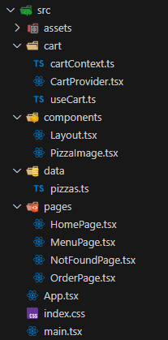

# Al's Pizza

_This is a project for a course for learning Claude Code. This project is AI-generated_

## GitHub Page
https://tkatra.github.io/Al-s-Pizza/

Demo website for the pizzeria Al's Pizza, built with React 19, TypeScript, Vite and React Router.

## Pages

- **Home** (`/`) – the pizzeria name and directions to DootStreet 404B, Demo Town
- **Menu** (`/menu`) – all pizzas with ingredients and prices
- **Order online** (`/order`) – a cart at the top and a grid of pizzas to add to it
- **Page not found** (any other path) – a "Page not found" message with a button back to Home

## Getting started

```bash
npm install
npm run dev
```

Other scripts: `npm run build`, `npm run preview`, `npm run lint`.

## Architecture
The project was on purpose kept pretty simple to keep an eye on what the AI was doing.



### Src root
In the root of we keep the `main.tsx` and `App.tsx` files. `App.tsx` has the core of the application and `main.tsx` starts up the app. The `index.css` keeps the styling for the whole application.

### Cart
Since the cart is a bit more involved than everything else, the AI created its own folder and kept all of its functions there. This works because this is a smaller project, but if it was bigger I would prefer to keep different types of functions in more general folders.

### Components
Here are the components that are re-used in multiple other components. Currently the files in here are the general layout of the website and the file that constructs the image of the different pizzas on the order page.

### Data
This is the folder where general data files are kept, currentlly only the different types of pizzas are kept here.

### Pages
These are the different pages you can navigate in the application

## Technical stack
In this project i decided to use React combined with TypeScript. Since I wanted a small and simple application, React was chosen and since I'm a fan of the structure of object oriented programming (C# for example), I decided to use TypeScript.

## Limits
The application was kept pretty limited on purpose to keep it simple. You have a cart, but it's not visualized in a proper way, it's not in a different page and it's in the way of the pizzas on the order page. There is no order function in the cart, you can only add and remove pizzas.

## AI development
As mentioned above, this is a project I did for a course for learning how to use the Claude Code AI as a coding tool.
